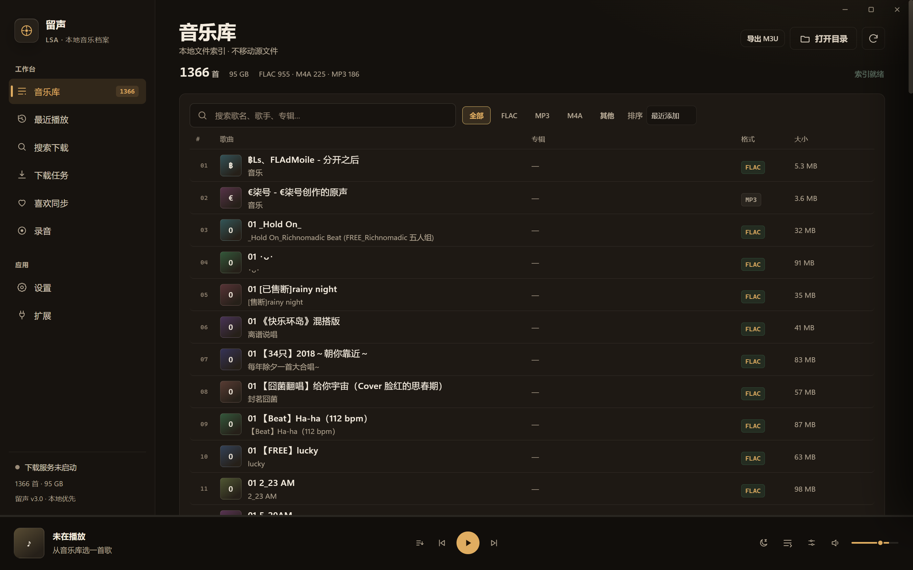

# LSA — Electron migration

Multi-platform host for **LSA / 留声**, a local-first music archive and player.

This directory is the Electron implementation of the desktop shell. It reuses
the existing `ui/` HTML/CSS/JS and replaces the Windows-only WinForms/WebView2
host with Electron.

The stable Windows client remains in `local-sound-archive` until this host
reaches parity.

## Status: M1 / M2 core



Implemented:

- Electron main process with a frameless Windows window;
- macOS `hiddenInset` title-bar mode;
- custom window drag surface and minimize/maximize/close controls;
- context-isolated preload bridge that emulates the old `window.chrome.webview`
  contract;
- local library scan;
- local HTTP audio server with `Range` support;
- FLAC playback through the existing Web Audio player;
- existing UI loaded unchanged inside the Electron host;
- local `.lrc` lyrics loading;
- local AI control API and MCP bridge (opt-in);
- search/download queue proxy when `go-music-dl` is running.

Not implemented yet:

- SQLite index and migrations;
- full library maintenance and duplicate handling;
- likes sync and account management;
- extension host;
- macOS packaging/signing/notarization;
- complete metadata/tag editing and production installer.

## Run on Windows

Requirements: Node.js 22+.

```powershell
npm install
$env:ELECTRON_RUN_AS_NODE = $null
$env:LSA_MUSIC_DIR = "D:\Music"   # optional; defaults to the OS Music folder
npm start
```

The app loads `ui/index.html` and scans the configured music directories.

The existing existing WebView UI calls `window.chrome.webview.postMessage`.
In Electron, `src/preload.js` exposes the same surface through a narrow
context-isolated bridge; the renderer never receives Node APIs.

## Structure

```text
src/main.js       Electron window, IPC, library scan, local audio server
src/preload.js    contextBridge shim for the existing renderer contract
ui/               copied renderer from the current client
docs/adr/         migration decision records
```

## Audio

The audio server binds to `127.0.0.1` on a random port and grants access only
to files inside the configured music roots. It supports CORS and byte ranges so
Chromium can play FLAC/MP3/M4A and Web Audio can process the stream.

## Window chrome

Windows uses `frame: false`; macOS uses `titleBarStyle: 'hiddenInset'`.
The custom controls are only rendered on Windows. The top drag surface uses
`-webkit-app-region: drag`, so there is no native Windows caption/title strip.

## Next milestone

M2: portable config, SQLite library index, metadata/lyrics, and a real
cross-platform path/config layer before packaging.


## AI control

The Electron shell includes the same local AI-control protocol as the Windows
client. Open:

```text
Settings → AI control → Enable
```

Then copy the generated MCP configuration. The endpoint is localhost-only and
requires the token in `data/ai-control.json`.

Supported tools: `music_status`, `music_search`, `music_play`, `music_pause`,
`music_resume`, `music_next`, `music_previous`, `music_seek`, `music_volume`
and `music_queue`.

## Online backend

When a local `go-music-dl` server is running on `127.0.0.1:18088`, the Electron
shell proxies search, download queue and task actions to it. The app does not
bundle the backend; start it separately and set `LSA_BACKEND_URL` if needed.


## Portable build

```powershell
npm run package:win
```

Output:

```text
release/LSA-portable/LSA.exe
```

The portable folder contains the Electron runtime and app resources; it does not
require Node.js or npm at runtime.

- SQLite index (`data/library.db`) and a persistent extension registry;
- local likes configuration and status store (platform sync engine remains platform-specific);
- single-process-safe portable launch and a verified `release/LSA-portable/LSA.exe`.
- an in-app extension manager scaffold with install/enable/disable/remove/safe mode;
- `electron-builder` Windows portable and macOS DMG/zip configuration with macOS entitlements.


Likes sync uses the bundled `scripts/likes-sync.mjs` against the local backend. It
requires a local `admin-credentials.txt` and platform cookies configured in the
backend. Reports go to the library `_报告` directory.
## macOS release

The mac build uses `electron-builder` with hardened runtime and the entitlements
in `build/entitlements.mac.plist`.

```bash
npm ci
CSC_IDENTITY_AUTO_DISCOVERY=false npm run package:mac
```

For a signed and notarized release, provide a Developer ID Application
certificate and Apple notarization credentials in the macOS environment; never
commit those values. The CI workflow builds an unsigned DMG/ZIP for verification.
