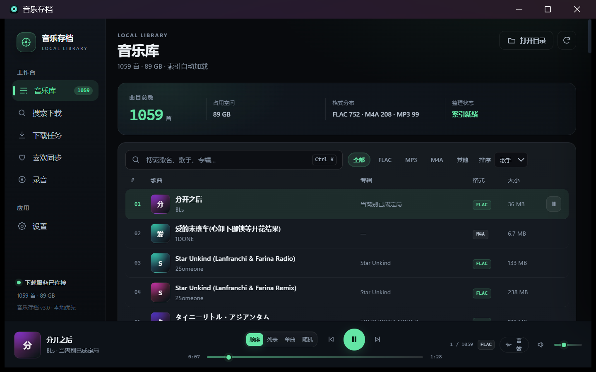
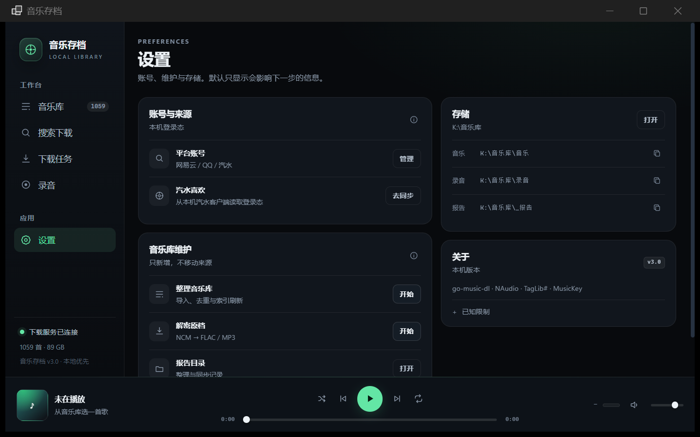

# LSA · 留声

跨平台、本地优先的音乐归档与播放器。  
A local-first music archive and player for Windows and macOS.



## 这是什么

LSA 把你的本地音乐整理成一个可检索的库：扫描、播放、歌词、平台搜索、下载任务、喜欢同步和 AI 控制在同一个桌面应用里完成。它不依赖网页播放器，也不把音乐上传到云端。

Electron 版本是原 Windows 客户端的跨平台宿主：保留原有 HTML/CSS/JS 界面，用 Electron 提供窗口、文件系统、音频服务、AI/MCP 桥接和平台打包。

## 当前功能

- 本地音乐库扫描与 SQLite 索引；
- FLAC / MP3 / M4A / 歌词播放；
- 自定义无边框窗口与完整窗口控制；
- 单实例唤醒与 Windows 托盘后台；
- 本地 HTTP 音频服务，支持 Range；
- 搜索、下载队列与任务操作；
- 网易云 / QQ 扫码登录，汽水客户端 Cookie 读取；
- 喜欢同步配置与状态；
- 扩展管理、搜索回退与扩展文档；
- 本地 AI 控制 HTTP API + MCP；
- 录音、设置、主题与界面比例；
- Windows 便携包与 macOS DMG/zip。




## 下载

Windows 便携版：

```text
release/LSA-portable/LSA.exe
```

macOS 使用 `electron-builder` 产出的 unsigned DMG/zip。首次打开需要在 Finder 中右键 → 打开，或按系统提示允许。

## 开发

要求 Node.js 22+。

```bash
npm ci
npm start
```

可选环境变量：

```text
LSA_MUSIC_DIR       覆盖音乐库目录，多个目录用系统路径分隔符
LSA_DATA_DIR        覆盖本地数据目录
LSA_BACKEND_URL     在线后端地址，默认 http://127.0.0.1:18088
```

## 配置

仓库里的 `config/default.json` 只放通用默认值，不含任何个人路径。个人目录、后端地址和平台凭据放在本地数据目录的 `config.json` / `admin-credentials.txt`，不会进入仓库或公开包。`config/local.example.json` 是带占位符的示例。

## 构建

Windows：

```bash
npm run package:win
```

macOS：

```bash
CSC_IDENTITY_AUTO_DISCOVERY=false npm run package:mac
```

macOS 构建使用 `build/entitlements.mac.plist` 的 hardened runtime 配置；正式签名/公证需要自备 Apple Developer 凭据，不随仓库提供。

## 发布审计

项目源码、配置、README 和 wrapper 启动器必须通过 `privacy-audit`。官方 Electron 运行时是第三方二进制，不能因为它自带的上游测试常量就把用户数据问题和它混为一谈；它的 SHA256 固定在 `config/privacy-allowlist.json`，只有哈希完全匹配时才跳过该 vendor 文件，项目自有的所有资源仍然正常扫描。

## 在线服务

搜索、扫码登录和下载依赖本机运行的 `go-music-dl` 服务，默认监听 `127.0.0.1:18088`。应用不会内置这个服务；请单独启动并配置管理员凭据。

## AI 控制

在设置中开启 AI control 后，应用会在本机启动仅限 localhost 的控制服务，并提供 MCP 配置。令牌保存在本地数据目录，不进入仓库。

## 结构

```text
src/main/index.js       Electron 主进程入口、窗口与 IPC 编排
src/main/services/      主进程领域服务（库、账号、扩展、喜欢）
src/preload/index.js    contextBridge 窄接口
ui/                     渲染层资源
ai-control/             本地 AI 控制协议与 MCP bridge
extension-sdk/          扩展契约、样例与文档
scripts/                便携打包、喜欢同步、启动器
config/                 公共默认配置与 vendor 审计锚点
docs/                   架构、工作流、ADR 与截图
```

架构与开发流程：

- [docs/architecture.md](docs/architecture.md)
- [docs/engineering-workflow.md](docs/engineering-workflow.md)
- [开源项目参考架构](docs/reference-architectures.md)
- [产品反思](docs/product-reflection-2026-10-31.md)
- [功能交付清单](docs/checklists/feature-delivery.md)
- [UI 交付门禁](docs/checklists/ui-delivery.md)

## License

MIT


